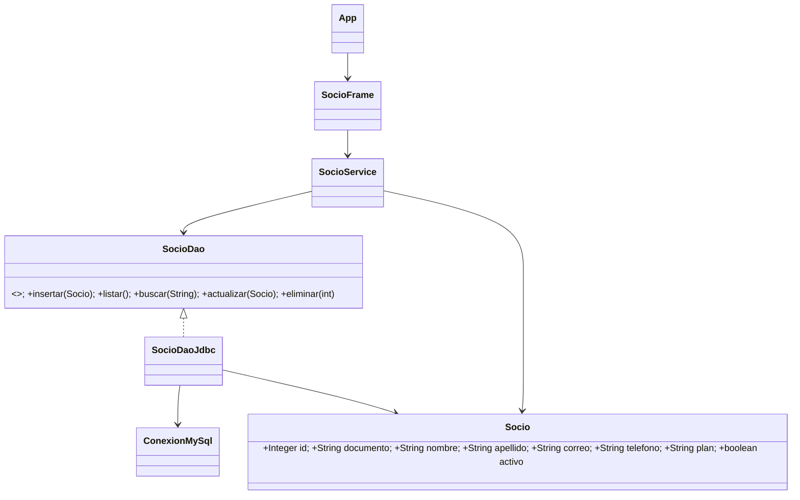

# Relación con artefactos previos del proyecto

**Proyecto:** Dracarys Gym · **Evidencia:** GA7-220501096-AA2-EV01

Este módulo Java/JDBC es una **implementación independiente de gestión de socios** para practicar la persistencia de datos solicitada en la evidencia. No reemplaza automáticamente la aplicación web existente, desarrollada con HTML, CSS, JavaScript, Node.js y MySQL. Para integrarlos se necesita adaptar el esquema y las reglas de negocio.

## Historias de usuario tomadas como alcance del módulo

- **HU-01:** Como administrador, quiero registrar un socio para conservar sus datos.
- **HU-02:** Como administrador, quiero consultar y buscar socios para localizar registros.
- **HU-03:** Como administrador, quiero modificar los datos de un socio para mantenerlos actualizados.
- **HU-04:** Como administrador, quiero eliminar un socio cuando se autorice retirar su registro.

Estas historias sintetizan las funcionalidades del módulo; deben cotejarse con las historias de usuario y diagramas oficiales del proyecto si existen diferencias.

## Casos de uso implementados

Actor: administrador del gimnasio. CU-01 Registrar socio; CU-02 Consultar socios; CU-03 Actualizar socio; CU-04 Eliminar socio. En los cuatro casos la interfaz llama a `SocioService`, que delega en `SocioDaoJdbc` y utiliza `ConexionMySql`.

## Diagrama de clases simplificado

## Diseño de interfaz

Ventana Swing con formulario de datos, tabla de registros, búsqueda y botones **Insertar**, **Actualizar**, **Eliminar**, **Limpiar** y **Mostrar todos**. Se emplean negro y amarillo como referencia visual de Dracarys Gym.

## Trazabilidad

| Historia | Método de servicio | Acceso a datos | Prueba sugerida |
|---|---|---|---|
| HU-01 | `registrar` | `INSERT` | Registrar documento nuevo |
| HU-02 | `listar`, `buscar` | `SELECT` | Consultar y filtrar por documento |
| HU-03 | `actualizar` | `UPDATE` | Editar plan y verificar cambio |
| HU-04 | `eliminar` | `DELETE` | Eliminar con confirmación |
